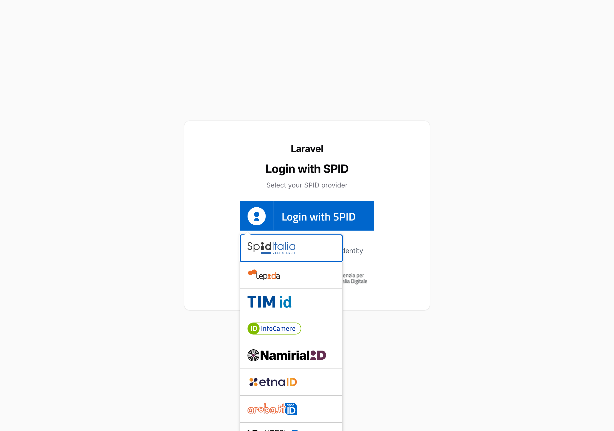

# Filament SPID — SPID authentication for Laravel Filament

[](https://packagist.org/packages/offline-agency/filament-spid)
[](https://packagist.org/packages/offline-agency/filament-spid)
[](https://github.com/offline-agency/filament-spid/actions/workflows/run-tests.yml?query=branch%3Amain)
[](https://github.com/offline-agency/filament-spid/actions/workflows/spid-validation.yml?query=branch%3Amain)
[](https://github.com/offline-agency/filament-spid/actions/workflows/phpstan.yml?query=branch%3Amain)
[](https://app.codecov.io/gh/offline-agency/filament-spid)
[](LICENSE.md)

Sign citizens in to [Filament](https://filamentphp.com) panels with
[SPID](https://www.spid.gov.it), the Italian public digital identity system,
over SAML 2.0. The SAML side is [italia/spid-laravel](https://github.com/italia/spid-laravel);
this plugin puts the SPID button on the panel login page, turns a validated
SPID identity into a login on the panel's guard, and adds an installer, a
doctor and an adapter for AgID's metadata validator.

A community package maintained by [Offline Agency](https://offlineagency.it),
released under the [MIT license](LICENSE.md). It is not an official Filament
plugin and not an AgID product, and installing it does not make a service
accredited to SPID: that takes AgID's own procedure (see
[Testing with AgID's tools](docs/testing/agid.md)).

Italiano: [guida in italiano](docs/it/README.md).



> **Pre-release.** This branch documents **1.0.0, which is not on Packagist yet**:
> `composer require offline-agency/filament-spid:^1.0` works once 1.0.0 is
> tagged. The published release is 0.1.8, documented in the
> [README at 0.1.8](https://github.com/offline-agency/filament-spid/blob/0.1.8/README.md);
> 0.1.x is no longer maintained ([SECURITY.md](SECURITY.md)).

## Requirements

| | Supported (every combination tested in CI) |
|---|---|
| PHP | 8.3, 8.4, 8.5 |
| Laravel | 12.x, 13.x |
| Filament | 3.x, 4.x, 5.x |
| SPID service provider | public and private SPs; aggregators and operators (gestori) are not covered |

Laravel 11 left security support on 12 March 2026 and PHP 8.2 leaves it on
31 December 2026 ([Laravel support policy](https://laravel.com/docs/13.x/releases#support-policy),
[PHP supported versions](https://www.php.net/supported-versions.php), checked
on 11 October 2026), so neither is supported by 1.x.

## Who does what

| | Responsible |
|---|---|
| SAML: AuthnRequest, Response validation, signatures, metadata; the SPID patch to `onelogin/php-saml`; the IdP list | [italia/spid-laravel](https://github.com/italia/spid-laravel) |
| The SPID button on the panel; login on the panel guard; fail-closed errors; optional provisioning; events; `filament-spid:install`, `filament-spid:doctor`, `filament-spid:metadata:validate` | this plugin |
| Who may enter (`canAccessPanel()`); the SP's identity, contacts and key pair; sessions; logout policy; data retention; HTTPS and proxies; AgID acceptance | your application and your organisation |

## Quick start

You need a Laravel 12 or 13 application with a Filament panel (`php artisan
filament:install --panels`), the SP's signing key pair (see
[Certificates](docs/installation.md#certificates)) and the SP's real data
(organisation, IPA code or VAT number, contact email).

<!-- quickstart:begin (docs/snippets/quickstart.sh, run in CI by .github/scripts/install-check.sh) -->
```bash
# Run in the root of a Laravel 12 or 13 application with a Filament panel.

# 1. italia/spid-laravel with the SPID patch for php-saml ^4.3.1: until
#    upstream tags a release, the offline-agency fork at a pinned commit.
composer config repositories.spid-laravel vcs https://github.com/offline-agency/spid-laravel
composer config allow-plugins.cweagans/composer-patches true
composer config extra.enable-patching true --json
composer require "italia/spid-laravel:dev-feat/laravel-13#b8dd1a484d8e6551a1a84e90220c2e9dc0d0a0fe as 2.1.0-beta" --no-update

# 2. The plugin.
composer require offline-agency/filament-spid:^1.0

# 3. Install and configure from setup.json (copy examples/setup.public.json or
#    setup.private.json from the package and fill in your SP's real data and
#    key pair paths). --dry-run shows the plan and writes nothing.
php artisan filament-spid:install --panel=admin --input=setup.json --dry-run
php artisan filament-spid:install --panel=admin --input=setup.json

# 4. Check.
php artisan migrate
php artisan filament-spid:doctor
```
<!-- quickstart:end -->

Why step 1: every tagged `italia/spid-laravel` (up to v2.1.0-beta) pins
`onelogin/php-saml` 4.1.0, affected by
[CVE-2025-66475](https://github.com/advisories/GHSA-5j8p-438x-rgg5). The fix is
merged upstream ([italia/spid-laravel#132](https://github.com/italia/spid-laravel/pull/132))
but not tagged; the fork is pinned to a commit whose patch URL is pinned too,
so the SPID patch cannot change under you. Only `italia/spid-laravel` gets a
dev constraint: your `minimum-stability` stays as it is.
[#16](https://github.com/offline-agency/filament-spid/issues/16) tracks the
switch to the tagged release.

Without `--input` the installer asks the questions. Either way it validates
everything before writing, shows the plan, keeps existing files, registers the
plugin after `->login()`, exempts only the ACS from CSRF, and lists what it
could not do safely as manual steps (then exits with 1). Running it again
changes nothing.

Then decide who may enter. SPID proves who the citizen is, not what they may
do:

```php
use Filament\Models\Contracts\FilamentUser;
use Filament\Panel;

class User extends Authenticatable implements FilamentUser
{
    protected $fillable = ['name', 'email', 'password', 'fiscal_code', 'spid_data'];

    protected $casts = ['spid_data' => 'array'];

    public function canAccessPanel(Panel $panel): bool
    {
        // Your own rule, e.g. a role column your application defines and manages.
        return $panel->getId() === 'admin' && $this->role === 'administrator';
    }
}
```

Accounts are matched by fiscal code, never by email. No account is created for
a SPID citizen unless you turn `auto_create_users` on, and even then
`canAccessPanel()` decides who gets in.

## Documentation

- [Installation and configuration](docs/installation.md): the installer and its input, manual installation, public and private SPs, certificates, CSRF, proxies.
- [Configuration reference](docs/configuration.md): every key, SPID levels, data minimisation, field mapping, multiple panels, the SPID button.
- [How login works](docs/authentication.md): the success boundary, fail-closed errors, guards and sessions, provisioning, events and transactions, local logout and SLO.
- [Diagnostics](docs/diagnostics.md): `filament-spid:doctor` and `filament-spid:metadata:validate`.
- [Testing with AgID's tools](docs/testing/agid.md): the local lab, `spid_sp_test`, the AgID Validator, the acceptance test. [What has been verified](docs/testing/evidence.md).
- [Production checklist](docs/production-checklist.md) · [Troubleshooting](docs/troubleshooting.md) · [FAQ](docs/faq.md) · [Upgrading from 0.1.x](docs/upgrading.md)

AI coding agents: the package ships [Laravel Boost](https://laravel.com/docs/boost)
guidelines and a `spid-integration` skill, which `php artisan boost:install`
installs when the package is a direct dependency.

## Development

```bash
composer test
composer analyse
vendor/bin/pint --test
node --test 'tests/js/*.test.mjs'
```

See [CONTRIBUTING](CONTRIBUTING.md) for the local setup that mirrors CI, the
SPID lab and the release flow.

## Changelog, security, support

- [CHANGELOG](CHANGELOG.md)
- [Security policy](SECURITY.md): report vulnerabilities by email, never in a public issue.
- Questions and bugs: [GitHub issues](https://github.com/offline-agency/filament-spid/issues) or support@offlineagency.it.
- [Contributing](CONTRIBUTING.md) and the [Code of Conduct](CODE_OF_CONDUCT.md).

## Credits

- [Offline Agency](https://offlineagency.it) and [all contributors](../../contributors)
- [italia/spid-laravel](https://github.com/italia/spid-laravel), the SAML integration this plugin builds on
- [italia/spid-sp-test](https://github.com/italia/spid-sp-test) and [italia/spid-saml-check](https://github.com/italia/spid-saml-check), the validation tools

## License

MIT. See [LICENSE.md](LICENSE.md).
